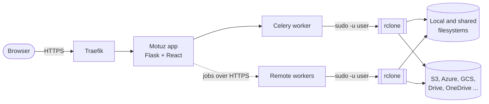

---
hide:
  - navigation
  - toc
---

<div class="mz-hero" markdown>

<div class="mz-hero__text" markdown>

<span class="mz-eyebrow">Open source data mover for research computing</span>

# Move petabytes between your storage and the cloud { .mz-title }

Motuz is a web interface and REST API for large data transfers. Users browse two panes,
drag folders from one side to the other, and Motuz copies them with
[rclone](https://rclone.org/), checks every file, and tells them when it is done.

[Get started :lucide-arrow-right:](quick-start.md){ .md-button .md-button--primary }
[See the features](features/index.md){ .md-button }

</div>

<div class="mz-hero__art">
  
</div>

</div>

<div class="mz-stats" markdown>

<div markdown>**10**<br>storage types</div>
<div markdown>**64**<br>parallel transfers</div>
<div markdown>**1**<br>sudoers rule</div>
<div markdown>**2**<br>install steps</div>

</div>

## Everything a transfer needs { .mz-center }

<div class="grid cards mz-cards" markdown>

-   :lucide-cloud: **Every storage you use**

    ---

    Local and shared filesystems, Amazon S3, Ceph and other S3 servers, Azure Blob,
    Google Cloud Storage, Swift, SFTP, WebDAV, Dropbox, OneDrive and Google Drive.

    [:lucide-arrow-right: S3 connections](features/s3-connections.md)

-   :lucide-shield-check: **The user's own permissions**

    ---

    Every file operation runs as the logged-in user through one narrow sudoers rule,
    so the operating system enforces the same access as on the command line.

    [:lucide-arrow-right: Why a sudoers rule](install-default-without-docker.md#why-a-sudoers-rule)

-   :lucide-badge-check: **Integrity checks**

    ---

    A check job compares the checksums of source and destination: CRC32C where the
    storage keeps it, so a check of S3 data needs no download.

    [:lucide-arrow-right: All features](features/index.md)

-   :lucide-gauge: **Fast by default**

    ---

    Measured defaults of 64 transfers and 128 checkers, large S3 parts, and limits
    that fit the memory of the server.

    [:lucide-arrow-right: Performance tuning](features/performance-tuning.md)

-   :lucide-calendar-clock: **Scheduled copies**

    ---

    Repeat a copy every hour, day, week or month. Scheduled runs only add new files:
    they never delete and never overwrite.

    [:lucide-arrow-right: Scheduled copies](features/scheduled-copies.md)

-   :lucide-server: **Workers anywhere**

    ---

    Run jobs on remote workers that need only outgoing HTTPS, or on temporary EC2
    instances that stop when their job is done.

    [:lucide-arrow-right: Remote workers](features/remote-workers-https-only.md)

-   :lucide-receipt: **No surprise cloud bills**

    ---

    Before a copy out of AWS, Motuz shows the estimated egress cost, and the user must
    confirm it.

    [:lucide-arrow-right: AWS egress cost](features/aws-egress-cost.md)

-   :lucide-upload: **Uploads from the desktop**

    ---

    Drop files from the desktop onto a pane. They stream straight to the destination,
    with the same progress bar as a copy.

    [:lucide-arrow-right: Uploads](features/uploads-from-the-desktop.md)

-   :lucide-file-search: **Look before you copy**

    ---

    Open text, logs, images, Markdown, PDF and Office files in the browser, read as the
    user, without a download.

    [:lucide-arrow-right: File viewer](features/file-viewer.md)

</div>

## See it work { .mz-center }

=== "Copy and check"

    { .mz-shot }

=== "Settings"

    { .mz-shot }

## How it works { .mz-center }



The app never touches a file itself: rclone runs as the logged-in user, with that user's
permissions. Credentials are encrypted in the database, and the server's secrets never
reach the user's processes.

## Install in minutes { .mz-center }

=== "Without Docker (default)"

    Ubuntu 26.04 or Amazon Linux 2027. Root runs one short, reviewable step; everything
    else runs as the service account `motuz`.

    ```bash
    sudo git clone https://github.com/dirkpetersen/motuz.git /root/motuz-install
    sudo /root/motuz-install/bin/systemd/install.sh --local-accounts

    sudo -iu motuz
    git clone https://github.com/dirkpetersen/motuz.git ~/motuz
    ~/motuz/bin/systemd/deploy.sh   # ends with "Motuz is up: https://<host>/"
    ```

    [:lucide-arrow-right: The full quick start](quick-start.md)

=== "Docker"

    ```bash
    git clone https://github.com/dirkpetersen/motuz.git
    cd motuz
    ./bin/quickstart.sh
    ```

    Then open <http://localhost/> and accept the self-signed certificate.

    [:lucide-arrow-right: Docker install](alternative-docker.md)

<div class="mz-cta" markdown>

**Ready to move data?** Start with the [quick start](quick-start.md), or read the
code on [GitHub](https://github.com/dirkpetersen/motuz).

</div>
